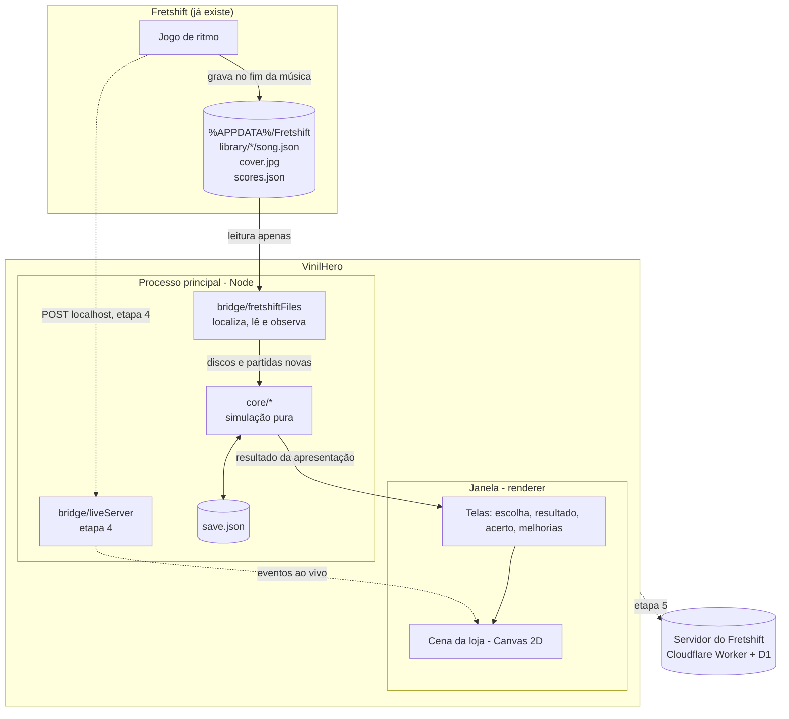
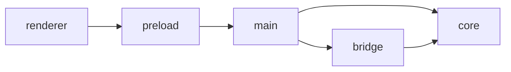
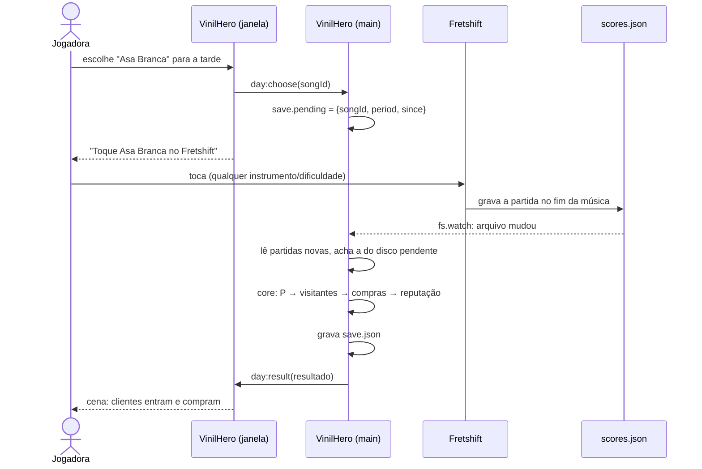

# Arquitetura

## Visão geral

O VinilHero é um **app de PC separado** (Electron), instalado ao lado do Fretshift. Ele não altera o
Fretshift: na primeira versão só **lê** a biblioteca e as partidas.



## Tecnologia

A mesma base do Fretshift, para reaproveitar o conhecimento e trechos de código
([D-01](../decisoes/index.md#d-01-app-separado-em-electron-mesma-base-do-fretshift)):

| Parte | Escolha |
|---|---|
| App | Electron, JavaScript com módulos ES (`"type": "module"`), Node 22 |
| Testes | `node --test` + ESLint (`npm test` = `eslint . && node --test`) |
| Interface | HTML/CSS para as telas, Canvas 2D para a cena da loja |
| Arte | pixel art 2D simples, sprites em PNG (bonecos por arquétipo, móveis por melhoria) |
| Dependências | nenhuma de execução na etapa 1 a 4; `@azure/msal-node` na etapa 5 (login, igual ao Fretshift) |
| Distribuição | electron-builder (NSIS), igual ao Fretshift |

## Estrutura de pastas

```text
vinilhero/
├── package.json
├── eslint.config.js
├── mkdocs.yml
├── docs/
├── build/icon.png               ← ícone do instalador (gerado por scripts/icone.js)
├── scripts/icone.js
├── src/
│   ├── core/                    ← puro: sem Electron, sem fs, sem Date.now(); 100% testável
│   │   ├── balance.js           ← TODOS os números do design (pesos, preços, fatores)
│   │   ├── rng.js               ← sorteio com semente (mulberry32) e hash de texto
│   │   ├── records.js           ← song.json → disco (etiquetas, energia, seção sugerida)
│   │   ├── performance.js       ← partida → P; agrupar partidas da banda
│   │   ├── customers.js         ← mistura de arquétipos, sorteio dos visitantes
│   │   ├── simulation.js        ← apresentação → visitantes, compras, faturamento, reputação
│   │   ├── plays.js             ← partidas → histórico dos discos; resolve a apresentação pendente
│   │   ├── shelves.js           ← seções, capacidade das prateleiras, depósito
│   │   ├── requests.js          ← pedidos do dia (gerar e conferir se foram atendidos)
│   │   ├── events.js            ← evento do dia (sorteio, fator E, Noite de karaokê)
│   │   ├── stock.js             ← estoque: encomendas, reposição automática, chegada
│   │   ├── economy.js           ← aluguel, melhorias e expansões
│   │   ├── manage.js            ← gestão: disco em destaque, promoções, eventos da loja
│   │   ├── regulars.js          ← clientes fixos: pedidos, capítulos, visitas
│   │   ├── stories.js           ← histórias da vizinhança e conversas entre clientes
│   │   ├── decor.js             ← decoração (só visual)
│   │   ├── achievements.js      ← conquistas da coleção
│   │   ├── milestones.js        ← caminho da loja (7 marcos)
│   │   ├── social.js            ← lojas rivais: referência, disco da semana, resumo da loja
│   │   ├── live.js              ← ponte ao vivo: eventos da partida → cena
│   │   ├── day.js               ← máquina de estados do dia (abertura → … → acerto)
│   │   └── saveFormat.js        ← formato do save, valores iniciais e migração de versão
│   ├── bridge/                  ← tudo que toca no Fretshift
│   │   ├── fretshiftPaths.js    ← onde estão os dados do Fretshift
│   │   ├── fretshiftFiles.js    ← ler biblioteca e scores.json; observar mudanças
│   │   └── liveServer.js        ← etapa 4: servidor HTTP local para a ponte ao vivo
│   ├── main/
│   │   ├── main.js              ← janela, IPC, observa o Fretshift
│   │   ├── game.js              ← o jogo em andamento (save + biblioteca + partidas + core); testável sem Electron
│   │   ├── saveFile.js          ← save.json: escrita atômica com fsync, .bak, backups diários, recuperação
│   │   ├── launch.js            ← abrir o Fretshift e confirmar que o processo nasceu
│   │   ├── social.js            ← servidor das lojas: cache, validação das respostas, limite de atualização
│   │   ├── store.js             ← JSON com escrita atômica (copiado do Fretshift)
│   │   └── preload.cjs          ← API exposta à janela
│   ├── renderer/
│   │   ├── index.html
│   │   ├── app.js               ← troca de telas
│   │   ├── chart.js             ← gráfico de linha em SVG (Minha loja)
│   │   ├── screens/             ← escolha.js (+ quadro.js: pedidos e evento; cena.js: a loja agora;
│   │   │                          conversa.js: conversas), aguardando.js, resultado.js, acerto.js,
│   │   │                          melhorias.js, decorar.js, estoque.js, gestao.js, minhaloja.js,
│   │   │                          colecao.js, caderno.js, vizinhanca.js, aovivo.js
│   │   ├── textos-clientes.js   ← falas e capítulos dos clientes fixos
│   │   ├── textos-historias.js  ← histórias, conversas e reações
│   │   └── scene/               ← loja.js (desenho, decoração, luz), atores.js (bonecos e balões),
│   │                              animacao.js (linha do tempo do resultado), ambiente.js (a loja
│   │                              funcionando), sons.js (efeitos sintetizados com WebAudio)
│   └── cli/
│       └── simular.js           ← simulador de balanceamento (npm run simular)
└── test/
```

### Regra de dependência



- `core/` **não importa nada** de fora de `core/`. Recebe dados prontos (objetos) e devolve dados.
- Hora e sorteio entram como parâmetro (`now`, `seed`), nunca são lidos lá dentro.
- O renderer **não calcula** resultado: só anima o que o processo principal mandou. Assim a animação
  pode mudar à vontade sem mexer no balanceamento.

## Fluxo de uma apresentação



## Comunicação janela ↔ processo principal (IPC)

| Canal | Sentido | Conteúdo |
|---|---|---|
| `state:get` | janela → main | estado da loja para desenhar (dia, período, dinheiro, prateleiras, melhorias, resultados ainda não vistos) |
| `state:changed` | main → janela | o estado mudou sozinho (partida chegou, disco novo na biblioteca) |
| `day:choose` | janela → main | `{ songId, mode: 'play' \| 'passive' \| 'show' }` |
| `day:cancel` | janela → main | cancela a espera |
| `day:seen` | janela → main | a janela já mostrou os resultados e avisos pendentes |
| `day:close` | janela → main | fecha o dia (acerto) |
| `day:open` | janela → main | abre o dia seguinte |
| `shop:buy` | janela → main | `{ upgradeId, section? }` (section só na prateleira extra) |
| `record:move` | janela → main | `{ songId, section }` |
| `fretshift:status` | main → janela | pasta encontrada?, nº de discos, última leitura, erro |
| `live:event` | main → janela | eventos da ponte ao vivo (etapa 4) |

As ações devolvem `{ ok: true, state }` ou `{ ok: false, error }`, com `error` sendo um código
(`shelfFull`, `debt`, `notOnShelf`…) que a janela traduz em `src/renderer/text.js`. Os resultados das
apresentações chegam dentro do estado (`state.unseen`), inclusive os resolvidos com o VinilHero
fechado: a janela mostra um de cada vez e avisa com `day:seen`.
