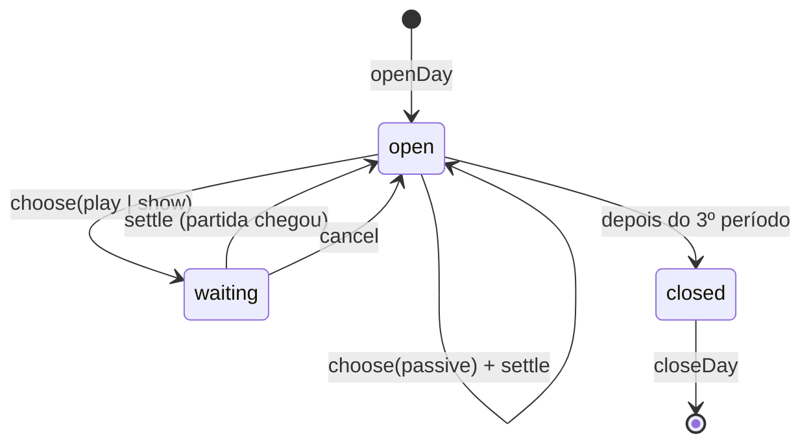

# Simulação

O núcleo (`src/core/`) é um conjunto de **funções puras**: mesma entrada, mesma saída. Isso permite
testar cada regra do design e rodar milhares de dias no simulador de balanceamento.

## Sorteios com semente

Todo sorteio usa um gerador com semente (`mulberry32`), nunca `Math.random()`.

```js
// src/core/rng.js
export function mulberry32(seed) {
  let a = seed >>> 0;
  return () => {
    a = (a + 0x6d2b79f5) >>> 0;
    let t = Math.imul(a ^ (a >>> 15), 1 | a);
    t = (t + Math.imul(t ^ (t >>> 7), 61 | t)) ^ t;
    return ((t ^ (t >>> 14)) >>> 0) / 4294967296;
  };
}

/** Semente a partir de texto (FNV-1a de 32 bits). */
export function seedFrom(...parts) {
  let h = 0x811c9dc5;
  for (const ch of parts.join('|')) {
    h ^= ch.codePointAt(0);
    h = Math.imul(h, 0x01000193);
  }
  return h >>> 0;
}
```

| Sorteio | Semente | Consequência |
|---|---|---|
| Clientes e compras de uma apresentação | `seedFrom(save.seed, playId)` | refazer o cálculo dá o mesmo resultado; fechar e abrir o jogo não "rerrola" |
| Apresentação "só pôr pra tocar" | `seedFrom(save.seed, dia, período, songId)` | idem |
| Pedidos e evento do dia | `seedFrom(save.seed, 'dia', dia)` | o dia é o mesmo mesmo que o jogo feche |

`save.seed` é sorteado uma vez, na criação da loja.

## Funções principais

```js
// performance.js
performanceOf(play)                       // → P (0..1)

// customers.js
customerMix({ difficulty, period, reputation, event })   // → pesos por arquétipo
drawVisitors(rng, count, mix, records)                   // → [{ archetype, section?, instrument?, budget }]

// simulation.js
resolvePresentation({ state, record, play, mode, rng, live })
// → {
//     P, visitors: [...], purchases: [{ visitor, songId, price }],
//     revenue, reputationDelta, requestsDone: [...], reasons: ["Expert com 4 estrelas atraiu 2 colecionadores"]
//   }

// day.js  (máquina de estados; sempre devolve um estado novo)
openDay(state, { rng })                   // pedidos e evento
choose(state, { songId, mode, now })      // → state com pending
settle(state, result)                     // aplica o resultado ao estado
closeDay(state)                           // → { state, summary } (aluguel, saldo, títulos)

// economy.js
canBuy(state, upgradeId) / buy(state, upgradeId)
rent(state)
```

### Estado do dia



`state.period` avança no `settle`: manhã → tarde → noite → (fechar o dia).

### Exemplo de teste

```js
// test/simulation.test.js
import { test } from 'node:test';
import assert from 'node:assert/strict';
import { performanceOf } from '../src/core/performance.js';

test('partida do exemplo do scores.json dá P ≈ 0,71', () => {
  const P = performanceOf({ accuracy: 0.93, stars: 4, maxCombo: 182, totalNotes: 813, instrument: 'guitar' });
  assert.ok(Math.abs(P - 0.712) < 0.005);
});

test('mesma semente, mesmo resultado', () => { /* resolvePresentation 2× → deepEqual */ });
test('Fácil perfeita e Expert com P 0,71 rendem movimento parecido (±10%)', () => { /* … */ });
test('só pôr pra tocar não muda a reputação', () => { /* … */ });
test('3ª repetição no dia rende 35%', () => { /* … */ });
```

Os exemplos numéricos de [Performance e movimento](../design/performance.md) viram testes: se o
`balance.js` mudar, os testes mostram qual exemplo da documentação precisa ser atualizado.

## Simulador de balanceamento

`npm run simular` (`src/cli/simular.js`) joga muitos dias com jogadores fictícios e imprime a
evolução da loja, para conferir as [metas de ritmo](../design/progressao.md#metas-de-ritmo-para-a-calibragem).

```text
npm run simular -- --dias 40 --perfil bom --biblioteca 30 --sementes 200

perfil "bom" (P ~ N(0,75; 0,1), Expert, 3 apresentações/dia, compra a melhoria mais barata)
dia   saldo   reputação  título             melhorias
  1     612        8.9   Lojinha de bairro  —
  5    1480       19.7   Conhecida…         som 1, vitrine 1
  8    1190       27.0   Ponto de encontro  + palco
 ...
média de 200 sementes · palco no dia 7,4 (alvo 6–8) ✓ · reputação 50 no dia 26 (alvo ~25) ✓
```

Perfis: `passivo` (só põe pra tocar), `fraco` (P ≈ 0,3), `medio` (P ≈ 0,5), `bom` (P ≈ 0,75),
`perfeito_facil` (P = 1, Fácil). Os números de saída acima são ilustrativos: os reais saem da
calibragem.
