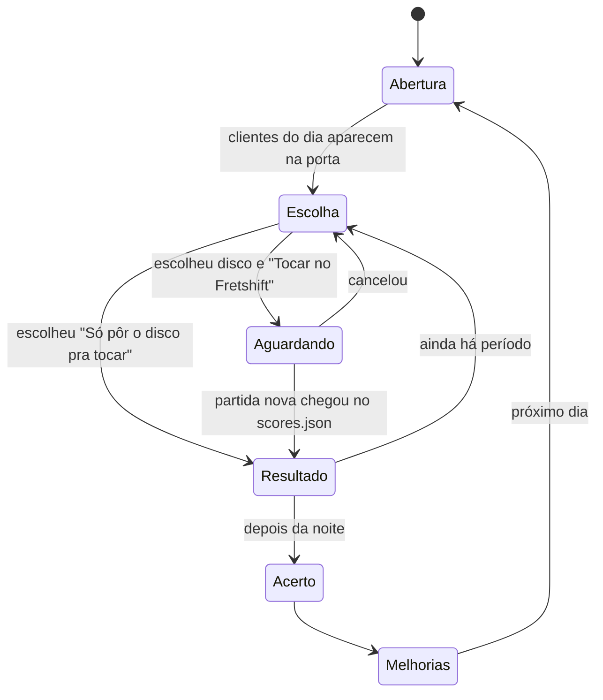

# Design do jogo

## Ciclo principal

O dia da loja tem **três períodos** (manhã, tarde, noite). Em cada um, o jogador escolhe **um disco**
para tocar na loja. Depois da noite vem o **acerto do dia**.

| Passo | O que o jogador vê | O que o jogador decide |
|---|---|---|
| **Abertura** | Loja vazia, quadro de **pedidos do dia** (2 ou 3 clientes com pedido), clima do dia | nada, só lê |
| **Escolha** | Prateleiras com os discos, sugestões ("cliente pediu algo rápido") | qual disco, e se vai tocar ou só pôr pra tocar |
| **Aguardando** | "Toque *Asa Branca* no Fretshift", com instrumento e dificuldade livres | toca no Fretshift |
| **Resultado** | Cena da loja: clientes entrando, comprando, saindo; números do período | nada; pode ver detalhes |
| **Acerto** | Vendas do dia, aluguel, saldo, reputação, pedidos atendidos | nada |
| **Melhorias** | Lista de melhorias e preços | o que comprar |

!!! tip "Tocar ou só pôr pra tocar"
    "Só pôr o disco pra tocar" existe para quem não quer jogar agora: dá o movimento de uma
    performance fraca (P = 0,25). Tocar bem rende muito mais, mas o jogo nunca trava esperando.

## A loja

Uma cena 2D vista de lado (uma "fatia" da loja): porta à esquerda, prateleiras no meio, caixa e
toca-discos à direita. As melhorias aparecem na cena (caixa de som maior, vitrine, palco, cabine,
cafeteria).

### Seções

| Seção | Sugerida quando |
|---|---|
| Rock e Metal | gênero com "rock", "metal", "punk"; ou bateria com nota ≥ 5 |
| Pop | gênero com "pop" |
| Brasil | gênero com "mpb", "samba", "forró", "sertanejo", "bossa", "baião" |
| Eletrônica | gênero com "electr", "eletr", "house", "techno", "edm" |
| Soul e Funk | gênero com "soul", "funk", "r&b", "disco" |
| Variados | todo o resto (padrão) |

A comparação ignora acentos e maiúsculas ("Forró" = "forro") e segue a ordem da tabela ("Pop Punk" vai para Rock e Metal). O `meta.genre` do Fretshift costuma vir vazio, por isso a sugestão é só um ponto de partida e o jogador
**move o disco** de seção quando quiser. As seções começam com 1 prateleira cada (8 discos) e crescem
com melhorias.

## Discos

Cada `song.json` da biblioteca do Fretshift vira um disco. O VinilHero calcula **etiquetas** a partir do
chart:

| Etiqueta | Regra | Para que serve |
|---|---|---|
| `rapida` | `bpm ≥ 140` | pedidos "algo agitado" |
| `lenta` | `bpm < 90` | pedidos "algo calmo" |
| `pesada` | `ratings.drums ≥ 5` | fãs de rock, músicos bateristas |
| `cantavel` | voz com letra (`instruments.vocals.lyrics`) | karaokê, clientes que cantam junto |
| `longa` / `curta` | `durationMs > 300 000` / `< 150 000` | hora do rush, pedidos de tempo |
| `energia` | notas por segundo do Expert da guitarra (ou bateria), de 0 a 1 | perfil do disco, conversão |

Energia: `nps = notas do Expert / duração em segundos`, `energia = limitar((nps − 1) / 7, 0, 1)`.

Um disco também guarda **histórico** (vezes tocado, melhor desempenho por instrumento) e o estado
**dominado** (5 estrelas em Difícil ou Expert).

## Clientes

Clientes são **arquétipos** com preferências. O movimento de uma apresentação diz *quantos* entram; a
mistura de arquétipos diz *quem* entra.

| Arquétipo | Peso na mistura | Gosta de | Gasta | Observação |
|---|---|---|---|---|
| Curioso | alto | qualquer coisa | R$ 40–60 | maioria das visitas; compra pouco |
| Fã de seção | médio | uma seção específica | R$ 55–85 | converte muito se o disco for da seção dele |
| Músico | baixo | um instrumento; alta precisão | R$ 50–80 | só compra se P ≥ 0,7 no instrumento dele |
| Colecionador | raro | Difícil/Expert, discos dominados | R$ 80–140 | aparece mais em Expert; fiel |
| Karaokeiro | baixo | etiqueta `cantavel`, partida de voz | R$ 40–65 | à noite, mais frequente |
| Crítico | muito raro | — | não compra | multiplica a variação de reputação por 3 |

Os números de mistura e preço ficam em [Progressão e economia](progressao.md) (calibrados na etapa 2).

### Pedidos do dia

Na abertura, 2 ou 3 clientes deixam um pedido no quadro (`src/core/requests.js`). Só saem pedidos que
algum disco da prateleira consegue atender. Atender dá gorjeta e +0,5 de reputação, e só vale
**tocando** ("só pôr pra tocar" não atende, [D-14](../decisoes/index.md#d-14-pedidos-so-valem-tocando)).
Uma apresentação pode atender mais de um pedido.

| Pedido | Atende com | Gorjeta |
|---|---|---|
| "Algo agitado pra animar a tarde" / "…pra noite" | disco `rapida` no período pedido | R$ 40 |
| "Algo calmo pra começar a manhã" | disco `lenta` de manhã | R$ 40 |
| "Quero ouvir algo pesado" | disco `pesada` | R$ 40 |
| "Tem alguma coisa de Brasil?" | disco da seção | R$ 40 |
| "Alguma coisa pra cantar junto" | partida de voz em disco `cantavel` | R$ 50 |
| "Quero ouvir uma bateria bem tocada" | partida do instrumento com P ≥ 0,7 | R$ 60 |
| "Me impressiona!" | 4 estrelas ou mais em Difícil/Expert | R$ 60 |
| cliente exigente ([evento](eventos.md#cliente-exigente)) | o disco dele, full combo em Médio+ | R$ 300 (+3 de reputação) |

Os tipos de pedido têm peso igual no sorteio (seção, que tem seis variações, não domina o quadro). Na
escolha, passar o mouse ou clicar num pedido destaca os discos que servem; os pedidos específicos
também marcam os discos com o selo "pedido".

No fim da cena de resultado, o quadro "Pedidos do quadro" mostra cada pedido aberto: os atendidos com a
gorjeta ("pedido atendido! +R$ 40") e os outros com o motivo, em uma linha ("só vale tocando no
Fretshift", "só vale de manhã", "esse disco não é cantável", "3 estrelas, precisava de 4"…). O motivo
vem de `missReason` (`src/core/requests.js`).

## Repetição

Tocar o mesmo disco de novo **no mesmo dia** rende menos (×0,6 na 2ª vez, ×0,35 na 3ª). Isso evita
"farmar" uma música fácil e incentiva usar a biblioteca. No dia seguinte o disco volta ao normal.
