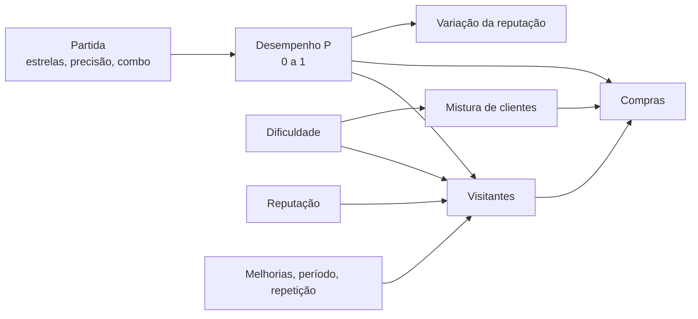

# Performance e movimento

Esta é a regra central do VinilHero: como uma partida do Fretshift vira gente na loja.



Todos os números desta página são **valores iniciais**. Eles ficam juntos em um arquivo só
(`src/core/balance.js`) para serem ajustados na calibragem da [etapa 2](../roteiro/etapa2.md).

## 1. Desempenho (P)

A partir de uma entrada do `scores.json` do Fretshift:

| Termo | Cálculo | Por quê |
|---|---|---|
| precisão normalizada `a'` | `limitar((accuracy − 0,5) / 0,5, 0, 1)` | abaixo de 50% de acerto não conta nada; a diferença entre 80% e 95% pesa |
| estrelas `s'` | `stars / 5` | o número que o jogador já reconhece |
| combo `c'` | `maxCombo / totalNotes` (voz: igual a `a'`) | premia constância |

```text
P = 0,45·a' + 0,35·s' + 0,20·c'
```

### Exemplos

| Partida | `a'` | `s'` | `c'` | **P** |
|---|---|---|---|---|
| Expert, 93%, ★★★★, combo 182 de 813 (o exemplo do `scores.json`) | 0,86 | 0,80 | 0,22 | **0,71** |
| Fácil, 100%, ★★★★★, full combo | 1,00 | 1,00 | 1,00 | **1,00** |
| Médio, 70%, ★★, combo 40 de 300 | 0,40 | 0,40 | 0,13 | **0,35** |
| Difícil, 50%, ★, combo 15 de 400 | 0,00 | 0,20 | 0,04 | **0,08** |
| "Só pôr o disco pra tocar" | — | — | — | **0,25** (fixo) |

### Qual partida conta

Enquanto a loja está **aguardando** um disco, vale a **primeira partida completa** desse disco
registrada depois do pedido (o Fretshift só grava a partida no fim da música). Tentar de novo não
substitui o resultado: isso mantém a tensão da apresentação. Partidas da **demonstração** não são
gravadas pelo Fretshift e, portanto, não contam.

**Várias pessoas** (o "Jogar juntos" do Fretshift): hoje o Fretshift **não grava** as partidas em
grupo (elas não entram nos recordes nem no ranking). O show da banda depende de uma pequena mudança
no Fretshift, prevista na [etapa 4](../roteiro/etapa4.md). Ver [Show da banda](eventos.md#show-da-banda).

## 2. Visitantes (movimento)

```text
V = arredondar( B · (0,3 + 1,4·P) · D · R · T · S · E )
```

| Fator | Valores | Observação |
|---|---|---|
| `B` base | `6 + reputação / 5` (6 a 26) | a fama da loja |
| `0,3 + 1,4P` | 0,3 (P = 0) a 1,7 (P = 1) | tocar muito bem dá ~5,7× tocar muito mal |
| `D` dificuldade | Fácil 0,9 · Médio 1,0 · Difícil 1,1 · Expert 1,2 · "só pôr pra tocar" 1,0 | |
| `R` repetição no dia | 1ª 1,0 · 2ª 0,6 · 3ª em diante 0,35 | |
| `T` período | manhã 0,7 · tarde 1,0 · noite 1,3 | |
| `S` caixa de som | nível 0 a 3: 1,0 · 1,15 · 1,3 · 1,5 | melhoria |
| `E` evento | 1,0 normalmente | ver [Eventos](eventos.md) |

### Exemplos (reputação 20, à tarde, sem melhorias: `B = 10`)

| Partida | Conta | Visitantes |
|---|---|---|
| Expert, P = 0,71 | 10 · 1,29 · 1,2 | **16** |
| Fácil perfeita, P = 1 | 10 · 1,70 · 0,9 | **15** |
| Médio, P = 0,35 | 10 · 0,79 · 1,0 | **8** |
| Só pôr pra tocar | 10 · 0,65 · 1,0 | **7** |
| Difícil, P = 0,08 | 10 · 0,41 · 1,1 | **5** |

!!! note "Equilíbrio entre dificuldades"
    Expert com ~70% de desempenho rende o mesmo movimento que Fácil perfeita. Quem joga em Fácil não é
    punido. Quem joga em Expert ganha **clientes melhores** (abaixo), não só mais clientes.

## 3. Quem entra (mistura de clientes)

Cada visitante recebe um arquétipo, sorteado com pesos:

| Arquétipo | Peso base | Fácil | Expert | Noite | Condição |
|---|---|---|---|---|---|
| Curioso | 50 | ×1,4 | ×0,8 | | |
| Fã de seção | 25 | | | | a seção dele é sorteada entre as seções com discos |
| Músico | 10 | ×0,6 | ×1,5 | | o instrumento dele é sorteado |
| Colecionador | 5 | ×0,3 | ×2,5 | | reputação ≥ 15 |
| Karaokeiro | 8 | | | ×2 | |
| Crítico | 2 | | | | reputação ≥ 30; no máximo 1 por dia |

(Médio e Difícil ficam no meio: Médio sem ajuste, Difícil com metade do ajuste do Expert.)

## 4. Compras (conversão)

Cada visitante compra **no máximo um disco** com chance:

```text
chance = base · afinidade · (0,5 + 0,5·P) · vitrine
```

| Arquétipo | Base | Afinidade 1,4 se… | Afinidade 0,6 se… |
|---|---|---|---|
| Curioso | 0,25 | — | — |
| Fã de seção | 0,45 | o disco é da seção dele | é de outra seção |
| Músico | 0,55 | tocou o instrumento dele | outro instrumento; **0 se P < 0,7** |
| Colecionador | 0,60 | Difícil/Expert ou disco dominado | Fácil |
| Karaokeiro | 0,50 | partida de voz | disco sem letra |
| Crítico | 0 | — | — |

- **Qual disco é comprado:** o disco tocado, com 70% de chance; senão, outro disco da mesma seção (o
  cliente "aproveitou para olhar a prateleira"). Na etapa 3, com estoque, um disco esgotado passa a
  vez para o próximo da seção.
- **Valor:** sorteado na faixa do arquétipo ([Progressão](progressao.md#precos)).

## 5. Reputação

Por apresentação:

```text
Δ = (P − 0,45) · 6      × 3 se houver crítico
    + 1,5               se full combo
    + 1                 por pedido atendido
```

- Quando o total é positivo, ele é reduzido perto do topo: `Δ × (1 − reputação / 150)`.
- **"Só pôr pra tocar" não muda a reputação** (Δ = 0): não jogar não é punido, só não avança.
- A reputação fica entre 0 e 100.

Exemplos com reputação 20 (redução de ×0,87 nos ganhos):

| Partida | Δ |
|---|---|
| P = 0,71 | +1,4 |
| P = 1, full combo | +4,2 |
| P = 0,35 | −0,6 |
| P = 0,08, com crítico | −6,7 |

## 6. Bônus da ponte ao vivo (etapa 4)

Com a [ponte ao vivo](../arquitetura/integracao.md#2-ponte-ao-vivo) ligada, o VinilHero recebe os
acionamentos de Star Power. Cada acionamento vira um **momento** na loja: +5% na chance de compra
daquela apresentação, até +15%. Sem a ponte, o resultado é o mesmo da fórmula acima. A ponte nunca é
obrigatória para progredir.

## Como a fórmula aparece na tela

O jogador não vê fórmulas. Ele vê:

- a fila na porta e os bonecos entrando (um boneco por visitante, cor por arquétipo);
- balões nos clientes ("que solo!", "vou levar", "hmm…");
- um painel de resultado com **visitantes**, **compras**, **faturamento** e uma seta de **reputação**;
- um "por quê" em uma linha: *"Expert com 4 estrelas atraiu 2 colecionadores."*
