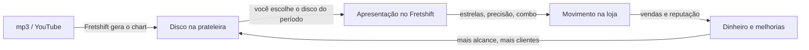

# VinilHero

**VinilHero** é um simulador de loja de discos ligado ao [Fretshift](https://github.com/LCavarcan/fretshift).
A biblioteca de músicas do Fretshift é o acervo da loja, e o movimento da loja depende de como você
toca essas músicas.

## Pilares

1. **A performance é o motor.** Tocar bem precisa *se sentir* na loja: mais gente, fila na porta,
   caixa tocando. A diferença entre tocar mal e tocar bem é grande e visível (cerca de 5×).
2. **Sua biblioteca é o jogo.** Nenhum disco é inventado: cada disco é uma música que você gerou no
   Fretshift. Variar o repertório é recompensado.
3. **Leve e por turnos.** O dia da loja anda por apresentações, não pelo relógio. Dá para jogar uma
   música, ver o resultado e parar. Não há punição por ficar dias sem abrir o jogo.
4. **Não depende do Fretshift mudar.** A primeira versão só **lê** os arquivos do Fretshift. As
   integrações mais ricas (loja ao vivo, abrir a música direto) vêm depois, como extras.
5. **Justo para todas as dificuldades.** Fácil com 5 estrelas e Expert com precisão razoável rendem
   parecido; o que muda é o *tipo* de cliente que aparece.

## O que fica de fora (por enquanto)

- Jogar ritmo dentro do VinilHero. O jogo de ritmo é sempre o Fretshift.
- Tempo real (a loja "funcionando" com o jogo fechado). Avaliado e descartado: ver
  [D-03](decisoes/index.md#d-03-dia-por-apresentacoes-nao-pelo-relogio).
- Comércio de discos de verdade, preços reais ou qualquer coisa ligada a lojas existentes.
- Celular. O VinilHero precisa ler arquivos do PC onde o Fretshift está instalado.

## Onde está cada coisa

- **Como o jogo funciona:** [Design do jogo](design/index.md)
- **A fórmula principal:** [Performance e movimento](design/performance.md)
- **Como o código vai ser organizado:** [Arquitetura](arquitetura/index.md)
- **O que fazer, em ordem:** [Roteiro](roteiro/index.md)
