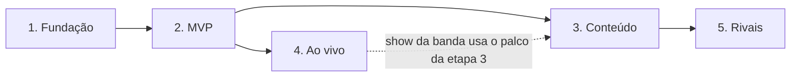

# Roteiro

Cinco etapas. Cada uma termina com algo **jogável ou verificável** e com os testes passando
(`npm test`).

| Etapa | Resultado | Muda o Fretshift? | Situação |
|---|---|---|---|
| [1. Fundação e leitura do Fretshift](etapa1.md) | o VinilHero abre, mostra a biblioteca como discos e vê partidas novas chegarem | não | feita; falta conferir com a biblioteca real |
| [2. Loja jogável (MVP)](etapa2.md) | um dia completo: escolher disco, tocar, ver clientes, fechar o dia, comprar melhoria | não | feita; faltam 3 dias jogados de verdade |
| [3. Clientes, estoque e eventos](etapa3.md) | pedidos, estoque, eventos, todas as melhorias, títulos, instalador | não | feita; faltam 7 dias jogados e testar o instalador num PC sem Node |
| [4. Loja ao vivo](etapa4.md) | loja reage durante a música, show da banda, "Tocar no Fretshift" | **sim** (opcional) | feita; falta publicar o Fretshift 0.2.0 e jogar com a ponte ligada |
| [5. Lojas rivais](etapa5.md) | lojas dos amigos, referência do disco, disco da semana | **sim** (servidor) | a fazer |

A etapa 4 pode vir antes da 3 se a vontade for ver a loja reagindo cedo: ela só depende da etapa 2.

## Como trabalhar em cada etapa

1. Ler a página da etapa e as páginas de design ligadas a ela.
2. Escrever primeiro o `core/` com testes (as regras), depois `bridge/` e `main/`, por último as telas.
3. Ao mudar um número do design, mudar em `src/core/balance.js` **e** na página do design (os testes
   dos exemplos avisam).
4. Ao terminar: atualizar a situação nesta tabela, registrar decisões novas em
   [Decisões](../decisoes/index.md) e fazer o commit.
